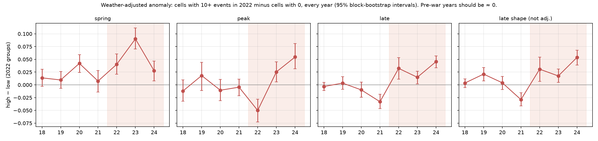

# Cropland and conflict in Kharkiv oblast, Ukraine (2018–2024)

Can satellite imagery, weather data and machine learning detect **abnormal cropland behaviour in a conflict
zone**, once normal weather and seasonal variation are accounted for?

This project follows 1,192 cropland squares of 5 × 5 km in Kharkiv oblast through seven growing seasons
(April–October 2018–2024). It uses Sentinel-2 greenness (NDVI), ERA5-Land weather and ACLED conflict events.

**Interactive dashboard:** *link follows after deployment* · **Report:** [`reports/report.md`](reports/report.md)
· **All experiments:** [`reports/experiments.md`](reports/experiments.md)

## Key findings

| Question | Answer |
|---|---|
| **RQ1** Can a weather-aware model trained on pre-war years predict "normal" greenness? | Yes, but only modestly. Gradient boosting beat a seasonal average on held-out pre-war years by 4–8% (MAE 0.088 vs 0.096 in 2021) and explains about 13% of year-to-year deviations. After 2022 it is off for the whole region, even far from fighting, so only **relative** comparisons are used. |
| **RQ2** Are weather-adjusted anomalies different where conflict was nearby? | Cropland with 10+ conflict events within 5 km had a **lower summer peak in 2022** (−0.05 NDVI vs squares with no events; pre-war difference ≈ 0) and was **greener than expected in spring 2023 and 2024** (+0.08 and +0.05). This is consistent with disrupted sowing followed by weedy or fallow fields. |
| **RQ3** Where fighting ended, did greenness return to normal? | Partly. Spring greenness was back to normal by 2024. At the peak and late in the season, these squares became *greener* than never-exposed squares instead. |
| Robustness (3 pre-registered checks) | 31 of 32 results hold under nearby-only comparisons, a 10 km exposure distance and no weather adjustment. The greener 2024 summer peak does not hold with nearby comparisons. |

These are **associations, not causal effects**. High- and low-exposure squares lie in different parts of the
region, and the 2022 peak result is not reproduced with UCDP data (fatal events only).

<p align="center">
  <br>
  <em>Weather-adjusted greenness of squares with 10+ conflict events in 2022 minus squares with none, every year (95% intervals).</em>
</p>

## How it works

```
Sentinel-2 L2A (Planetary Computer)  ─┐
ESA WorldCereal 2021 cropland mask    ├─► 14-day NDVI per 5 km cropland square ─┐
                                      ┘   (cloud mask, ≥ 50% clear cropland)    │
ERA5-Land weather ───────────────────────► 14-day weather features ─────────────┼─► panel (125,160 rows)
                                                                                │
         seasonal baseline (2018–21)  ◄──────────────────────────────────────────┘
         + gradient boosting on weather (trained on pre-war years only, forward validation)
                      │
                      ▼
         weather-adjusted anomalies 2022–24 ──► compared with ACLED conflict exposure (≤ 5 km, per season)
                                                event study · two-way fixed effects · recovery · robustness
```

Design choices that matter:
- **Pre-registration.** The conflict-exposure definition, the recovery rule and the robustness checks were written
  down and committed *before* any result was examined (see commit history and `reports/experiments.md`).
- **No leakage.** The model of "normal" only ever sees pre-war data and never uses past NDVI as an input. Validation
  is forward in time, never random.
- **Season shape, not only level.** Abandoned fields can look *greener* because of weeds, so peak, timing and
  late-season greenness are tracked separately.
- **Sentinel-2 processing baseline 04.00.** The +1000 reflectance offset from 25 Jan 2022 is corrected and
  unit-tested. Otherwise NDVI jumps exactly at the start of the war.
- **Negative results are reported.** This includes the failed bias check, the noisy peak timing, and the one
  robustness check that failed.

## Repository layout

| Path | Contents |
|---|---|
| `configs/kharkiv_v1.yaml` | every setting and decision (no hard-coded paths) |
| `src/agridisrupt/` | library: AOI/grid, Sentinel-2 reading, composites, climate, panel, models, conflict exposure, statistics |
| `scripts/` | one entry point per pipeline step (below) |
| `tests/` | 53 unit tests, including the 2022 offset correction and a dashboard smoke test |
| `reports/` | `experiments.md` (all experiments: hypothesis, method, result, limits), figures, result tables |
| `dashboard/` | Streamlit app + small public summary files |

## Reproduce

```bash
conda env create -f environment.yml && conda activate agri && pip install -e .
pytest                                                    # 53 tests (4 skip until the boundary is downloaded)

python scripts/download_boundary.py                       # oblast boundary (geoBoundaries)
python scripts/download_worldcereal.py                    # cropland mask tiles (~1.7 GB)
python scripts/select_pilot_block.py                      # 5 km grid + cropland share (+ pilot block)
python scripts/download_era5land.py                       # needs a Copernicus CDS key in ~/.cdsapirc
python scripts/build_climate_table.py
python scripts/inventory_oblast_scenes.py
bash   scripts/run_oblast_loop.sh                         # Sentinel-2 NDVI, ~6–40 h depending on bandwidth
python scripts/build_panel.py && python scripts/data_quality_report.py
python scripts/plot_overview.py && python scripts/run_baseline.py
python scripts/run_models.py && python scripts/evaluate_models.py
python scripts/download_ucdp.py
# ACLED: export Ukraine 2018–2024 event-level data (free account) into data/raw/acled/
python scripts/run_exposure_analysis.py && python scripts/run_recovery.py && python scripts/run_robustness.py
python scripts/build_dashboard_data.py && streamlit run dashboard/app.py
```

The pilot experiments (`inventory_pilot_scenes`, `run_pilot_timeseries`, `evaluate_pilot`, `compare_resolutions`)
document the feasibility tests from before the full run. Raw and processed data (`data/`) are not in the repository.

## Limitations

- Only four pre-war Sentinel-2 seasons, so the weather response is learned from few "year situations".
- Exposure is geographically clustered (north and east vs south-west). Nearby-only comparisons shrink the
  differences by a fifth to a third.
- ACLED counts also reflect reporting intensity. UCDP covers fatal events only.
- Yearly resolution for recovery, with two post-exposure seasons.
- 5 km squares mix crops, and crop rotation adds year-to-year noise that weather cannot explain.

## Ethics

Historical (2018–2024) and aggregated to 5 km squares and whole seasons only. No event locations, no front-line
tracking, no targeting-style output. The public dashboard shows exposure only as low/some/high groups.

## Data sources and licences

Copernicus Sentinel-2 data (2018–2024), accessed via Microsoft Planetary Computer · ERA5-Land, Copernicus Climate
Change Service (CC BY 4.0) · ESA WorldCereal 2021 (CC BY 4.0) · Armed Conflict Location & Event Data (ACLED),
acleddata.com (not redistributed here) · UCDP Georeferenced Event Dataset 26.1 (CC BY 4.0) · geoBoundaries.

---
Muhammad Yahya · BSc Business Analytics, University of Amsterdam · portfolio research project, 2026
