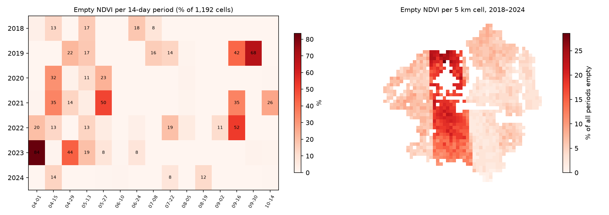

# Data-quality report — panel (NDVI + climate)

Generated by `scripts/data_quality_report.py` from `data/processed/panel.csv`.
Rule (config `panel.min_valid_share`): NDVI is kept only if >= 50% of the cell's cropland was clear in the 14-day period; `ndvi_raw` keeps every value.

## Overall
- Rows: 125,160 (1192 cells x 7 years x 15 periods). Climate columns: no missing values.
- No clear image at all: 1.8%. Below the 50% rule: 6.0%. **Empty in total: 7.8%.**
- Negative NDVI left after the rule: 0.

## Per year
```
      no clear image %  below rule %  empty total %
year                                               
2018               0.1           3.8            3.9
2019               2.8           9.2           12.0
2020               1.5           3.1            4.7
2021               2.6           8.5           11.1
2022               1.3           8.1            9.4
2023               4.0           7.1           11.1
2024               0.3           2.0            2.3
```

## Per 14-day period (all years)
```
       starts  no clear image %  below rule %  empty total %
period                                                      
0       04-01               8.4           6.9           15.3
1       04-15               2.9          12.3           15.2
2       04-29               1.8           9.8           11.6
3       05-13               2.1           9.6           11.7
4       05-27               3.1           9.2           12.3
5       06-10               0.0           0.2            0.2
6       06-24               0.1           3.9            4.0
7       07-08               0.2           3.2            3.4
8       07-22               0.5           5.3            5.8
9       08-05               0.4           0.8            1.2
10      08-19               0.3           1.4            1.7
11      09-02               0.1           1.5            1.6
12      09-16               1.8          16.7           18.5
13      09-30               2.8           7.2           10.0
14      10-14               2.5           1.5            4.0
```

## Per satellite tile
```
       no clear image %  below rule %  empty total %
tile                                                
36UXA               0.7           6.3            7.0
36UXV               2.5           7.5           10.0
36UYA               3.1          12.3           15.4
36UYU               0.0           1.3            1.3
36UYV               2.7           5.8            8.5
37UCP               1.0           1.4            2.4
37UCQ               1.9           2.5            4.4
37UCR               0.7           4.7            5.4
37UDQ               1.9           1.0            2.9
37UDR               0.6           3.6            4.2
```

## Per cell
- Share of periods empty per cell: median 5.7%, 90th percentile 18.1%, worst 28.6% (cell_00424).
- Cells with more than 20% of periods empty: 43.

## Gaps inside a season (cell x year, 15 periods each)
- Seasons: 8,344. Longest run of consecutive empty periods:
```
empty
0    3197
1    4309
2     780
3      49
4       4
5       5
```
- Seasons with a gap of 3+ periods (6+ weeks): 58 (0.7%).
- Seasons with NO clear value in the summer peak (periods 5-8, 10 Jun - 4 Aug): 0; with only 1 of 4: 1.


